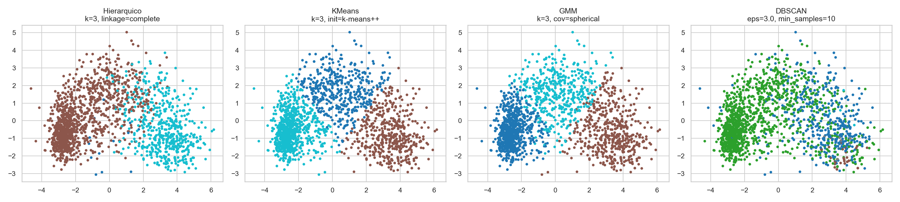
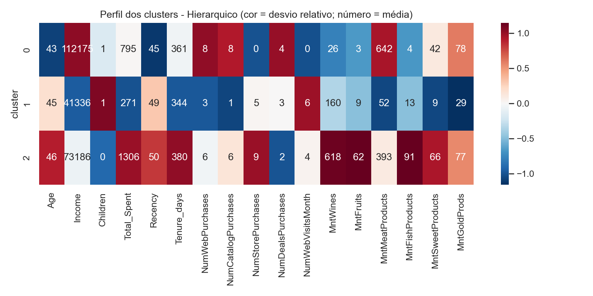

# Análise e Segmentação de Clientes (Customer Personality Analysis)

Projeto de **Mineração de Dados** focado em **Clusterização (Aprendizado Não Supervisionado)** aplicado à base *Customer Personality Analysis* (Kaggle), comparando quatro algoritmos de agrupamento: **K-Means**, **Hierárquico Aglomerativo**, **Gaussian Mixture Models (GMM)** e **DBSCAN**.

---

## Objetivo

Segmentar clientes a partir de características demográficas, hábitos de consumo e canais de compra para apoiar decisões de marketing e direcionamento de campanhas, utilizando um pipeline de pré-processamento **sem vazamento de dados (*data leakage*)** e avaliação por métricas internas, holdout e estabilidade por subamostragem.

---

## Estrutura do Projeto

```text
.
├── clusterizacao_customer_personality.py   # Pipeline completo de EDA, pré-processamento, modelagem e gráficos
├── marketing_campaign.csv                  # Base de dados (Customer Personality Analysis - separada por TAB)
├── requirements.txt                        # Dependências Python do projeto
├── Segmentação de Clientes por Clusterização Customer Personality Analysis.docx
└── outputs/                                # Tabelas CSV e gráficos PNG gerados pelo script
    ├── diagnostico_inicial.csv
    ├── resultados_todas_configuracoes.csv
    ├── comparacao_final.csv
    ├── perfil_clusters_Hierarquico.csv
    ├── outliers_antes_depois.png
    ├── correlacao.png
    ├── dbscan_kdist.png
    ├── kmeans_cotovelo.png
    ├── comparacao_k.png
    ├── clusters_pca.png
    └── perfil_heatmap.png
```

---

## Como Executar Localmente

### 1. Pré-requisitos
- Python 3.10+ (testado em Python 3.13.3)

### 2. Instalar dependências
```bash
pip install -r requirements.txt
```

### 3. Executar o pipeline
```bash
python clusterizacao_customer_personality.py
```

Todas as tabelas (`.csv`) e visualizações (`.png`) serão geradas automaticamente na pasta `outputs/`.

---

## Pipeline Metodológico

1. **Carga e Diagnóstico Inicial**
   - Base original com `2.240` registros e `29` colunas (`marketing_campaign.csv`, separador `\t`).
   - Identificação de valores ausentes em `Income` (`24` registros / `1,07%`).

2. **Engenharia de Atributos e Limpeza por Regras de Domínio**
   - Criação de `Age`, `Tenure_days`, `Children` e `Total_Spent` (usada apenas para perfilamento posterior).
   - Codificação ordinal de `Education` (`Education_ord`) e binária de `Marital_Status` (`Partner`).
   - Remoção de `4` registros com valores incompatíveis/errôneos (`Age > 100` ou `Income >= 600.000`).

3. **Pré-processamento sem Vazamento (Treino 80% / Holdout 20%)**
   - Split com `train_test_split(test_size=0.2, random_state=42)` resultando em `1.788` registros de treino e `448` de holdout com `19` atributos.
   - `SimpleImputer(strategy="median")`, winsorização por IQR (`1.5 * IQR` nas variáveis contínuas) e `StandardScaler` ajustados **somente no treino** e aplicados ao holdout.

4. **Modelagem Comparativa e Validação**
   - **K-Means**: $k \in [2, 10]$, `init` em `{"k-means++", "random"}` (+ curva do cotovelo e holdout).
   - **Hierárquico Aglomerativo**: $k \in [2, 10]$, `linkage` em `{"ward", "average", "complete", "single"}`.
   - **GMM**: $k \in [2, 10]$, `covariance_type` em `{"full", "tied", "diag", "spherical"}` (+ BIC e holdout).
   - **DBSCAN**: `eps` de `1.5` a `5.0` (passo `0.5`) e `min_samples` em `{5, 10, 15, 20}` (+ gráfico de *k*-distância).
   - **Seleção e Estabilidade**: seleção da melhor configuração por algoritmo com $k \ge 3$ (e ruído $\le 30\%$ no DBSCAN) pelo maior índice *Silhouette*, seguida de avaliação de estabilidade via **Adjusted Rand Index (ARI)** em 10 subamostras de 80%.

---

## Resultados Obtidos

### Comparação Final (melhor configuração por algoritmo)

| Algoritmo | Configuração | $k$ | Silhouette | Davies-Bouldin | Calinski-Harabasz | Estabilidade ARI (média ± dp) |
|---|---|---:|---:|---:|---:|---:|
| **Hierárquico** | `k=3, linkage=complete` | 3 | `0.251` | `2.171` | `319.087` | `0.492 ± 0.215` |
| **K-Means** | `k=3, init=k-means++` | 3 | `0.204` | `1.867` | `524.212` | `0.988 ± 0.005` |
| **GMM** | `k=3, cov=spherical` | 3 | `0.193` | `1.899` | `515.487` | `0.971 ± 0.013` |
| **DBSCAN** | `eps=3.0, min_samples=10` | 4 | `0.171` | `1.384` | `29.724` | `0.738 ± 0.033` |

### Visualizações





---

## Fonte dos Dados

- **Dataset**: [Customer Personality Analysis (Kaggle)](https://www.kaggle.com/datasets/imakash3011/customer-personality-analysis)
